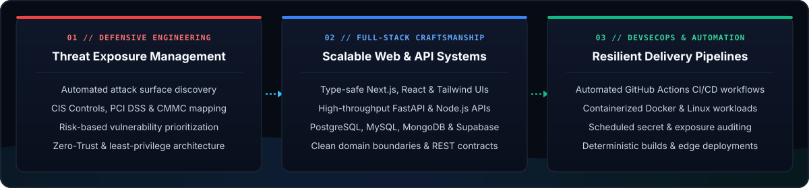
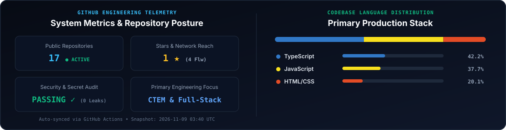

  <!-- EXECUTIVE SVG HERO BANNER -->
  

   

  <!-- DYNAMIC TYPING SUBTITLE -->
  

  <!-- PRIMARY CONTACT & PORTFOLIO CTA BADGES -->
  

    
    
    
  

  <!-- LIVE AUTOMATION & POSTURE WORKFLOW BADGES -->
  

    
    
    
    
  

---

## ⚡ Executive Overview

<table width="100%">
  <tr>
    <td width="62%" valign="top">
      

        I am a <b>Software Engineer at Cybersilo</b> specializing in enterprise <b>CTEM (Continuous Threat Exposure Management)</b> platforms and resilient full-stack web architectures.
      

      

        My core engineering work centers on automating attack surface discovery, risk-based asset prioritization, and mapping organizational posture against rigorous cybersecurity standards including <b>CIS Controls, PCI DSS, and CMMC</b>.
      

      

        Beyond security engineering, I architect and ship end-to-end production applications across the <b>TypeScript (Next.js, React, Node.js)</b> and <b>Python (FastAPI, Flask)</b> ecosystems—combining strict type safety, normalized data models, and deterministic CI/CD automation.
      

    </td>
    <td width="38%" valign="top">
      <table>
        <tr>
          <td><b>💼 Current Role</b></td>
          <td>Jr. Software Engineer @ <b>Cybersilo</b></td>
        </tr>
        <tr>
          <td><b>🛡️ Core Focus</b></td>
          <td>CTEM, Attack Surface &amp; Full-Stack</td>
        </tr>
        <tr>
          <td><b>📋 Frameworks</b></td>
          <td><code>CIS</code> • <code>PCI DSS</code> • <code>CMMC</code></td>
        </tr>
        <tr>
          <td><b>🎓 Education</b></td>
          <td>B.Sc. Computer Science <i>(May 2026)</i> PMAS-Arid Agriculture University</td>
        </tr>
        <tr>
          <td><b>🌍 Location</b></td>
          <td>Gujrat, Pakistan <i>(Global Remote)</i></td>
        </tr>
      </table>
    </td>
  </tr>
</table>

---

## 🏛️ Core Engineering Pillars

  

---

## 🛠️ Tech Stack & Architecture Arsenal

<table width="100%">
  <thead>
    <tr>
      <th width="22%" align="left">Domain</th>
      <th width="36%" align="left">Technologies</th>
      <th width="42%" align="left">Production Capabilities</th>
    </tr>
  </thead>
  <tbody>
    <tr>
      <td><b>Core Languages</b></td>
      <td>
        
      </td>
      <td>Strict static typing, asynchronous concurrency, data parsing pipelines, and modular service design.</td>
    </tr>
    <tr>
      <td><b>Frontend Systems</b></td>
      <td>
        
      </td>
      <td>SSR/ISR App Router architectures, responsive executive dashboards, complex state management, and interactive 3D/WebGL views.</td>
    </tr>
    <tr>
      <td><b>Backend &amp; APIs</b></td>
      <td>
        
      </td>
      <td>High-throughput RESTful microservices, schema validation (Pydantic/Zod), RBAC authentication, and background task orchestration.</td>
    </tr>
    <tr>
      <td><b>Data &amp; Persistence</b></td>
      <td>
        
      </td>
      <td>Relational schema normalization, indexing optimization, document aggregation pipelines, and real-time row-level security.</td>
    </tr>
    <tr>
      <td><b>DevSecOps &amp; Cloud</b></td>
      <td>
        
      </td>
      <td>Containerized multi-stage builds, automated CI/CD workflows, secret &amp; exposure auditing, and edge network deployments.</td>
    </tr>
  </tbody>
</table>

---

## 🚀 Featured Production Systems & Engineering Portfolio

<table width="100%">
  <tr>
    <td width="50%" valign="top">
      <h3>🛡️ CTEM Platform <code>Cybersilo • Enterprise</code></h3>
      

        Continuous Threat Exposure Management platform engineered for automated attack surface reconnaissance, vulnerability aggregation, and live compliance posture scoring against <b>CIS Controls, PCI DSS, and CMMC</b>.
      

      

        <code>Python</code> • <code>FastAPI</code> • <code>React</code> • <code>Docker</code> • <code>DevSecOps</code>
      

    </td>
    <td width="50%" valign="top">
      <h3>🤝 TrustBridge <code>Production Platform</code></h3>
      

        Full-stack venture collaboration ecosystem connecting angel investors, startup founders, and backers with verifiable milestone tracking, role-governed workflows, and transparent capital pipelines.
      

      

        <code>React</code> • <code>Node.js</code> • <code>Express</code> • <code>MongoDB</code> • <code>REST API</code>
      

    </td>
  </tr>
  <tr>
    <td width="50%" valign="top">
      <h3>⚡ Gujrat Fans <code>Live Commercial</code></h3>
      

        High-performance B2B &amp; direct-to-consumer digital commerce platform built for an industrial manufacturing leader, featuring instant catalog filtering, optimized media delivery, and SEO-first rendering.
      

      

        <code>Next.js</code> • <code>TypeScript</code> • <code>Tailwind CSS</code> • <code>Vercel</code>
      

    </td>
    <td width="50%" valign="top">
      <h3>📅 Event Planner &amp; ⚙️ EPR System <code>Production / Active</code></h3>
      

        <b>Event Planner:</b> Full-lifecycle event coordination suite with automated scheduling &amp; real-time state sync. 
        <b>EPR System:</b> Enterprise planning &amp; resource management platform with granular RBAC and audit logging.
      

      

        <code>Next.js</code> • <code>TypeScript</code> • <code>PostgreSQL</code> • <code>Supabase</code> • <code>Node.js</code>
      

    </td>
  </tr>
</table>

  <b>Explore interactive case studies and live deployments on <a href="https://www.zain-imran.com">www.zain-imran.com →</a></b>

---

## 📊 Live Engineering Telemetry & Contribution Activity

  

  <picture>
    <source media="(prefers-color-scheme: dark)" srcset="https://raw.githubusercontent.com/zainImran864/zainImran864/output/github-contribution-grid-snake-dark.svg" />
    <source media="(prefers-color-scheme: light)" srcset="https://raw.githubusercontent.com/zainImran864/zainImran864/output/github-contribution-grid-snake.svg" />
    
  </picture>

---

## 💡 Weekly Engineering & DevSecOps Insight

<!-- WEEKLY-INSIGHT:START -->
> **🧩 Resilient API Architecture**
> 
> *"Good APIs are intuitive to use and practically impossible to misuse. Design interfaces from consumer ergonomics backward to the database."*
> 
> — **Joshua Bloch**
<!-- WEEKLY-INSIGHT:END -->

---

<!-- BACKEND SEARCH & DISCOVERABILITY INDEXING METADATA
#Roles: Full-Stack Developer | Junior Software Engineer | Software Engineer | DevSecOps Engineer | Backend Engineer | Frontend Developer
#CoreTechnologies: TypeScript | Python | JavaScript | React | Next.js | Node.js | FastAPI | Express | TailwindCSS
#Databases: MongoDB | PostgreSQL | MySQL | Supabase
#CloudAndDevOps: Docker | Linux | Git | GitHub Actions | CI/CD | Vercel | Postman
#CybersecurityAndCTEM: Continuous Threat Exposure Management | Attack Surface Management | CIS Controls | PCI DSS | CMMC | OWASP Top 10 | Vulnerability Assessment
#Location: Gujrat, Pakistan | Remote
-->

## 📬 Connect & Collaborate

<table width="100%">
  <tr>
    <td align="center" width="33%">
      <b>🌐 Web Portfolio</b> 
      <a href="https://www.zain-imran.com">www.zain-imran.com</a>
    </td>
    <td align="center" width="33%">
      <b>💼 LinkedIn Network</b> 
      <a href="https://www.linkedin.com/in/zainimran98/">linkedin.com/in/zainimran98</a>
    </td>
    <td align="center" width="34%">
      <b>📧 Direct Engineering Inquiry</b> 
      <a href="mailto:mirzazan3334@gmail.com">mirzazan3334@gmail.com</a>
    </td>
  </tr>
</table>

  Engineered with precision by <b>Zain Imran</b> • Automated telemetry &amp; security posture verified via GitHub Actions

